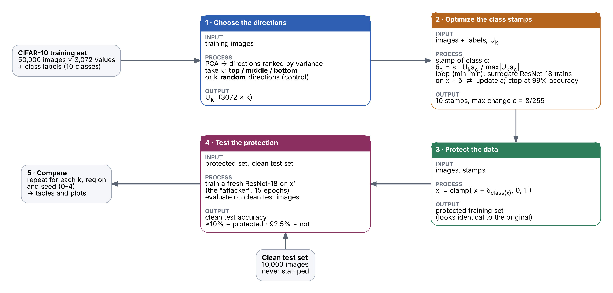
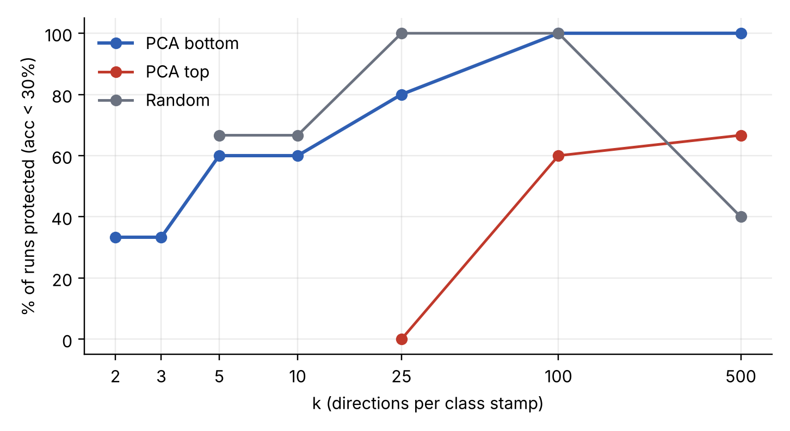

# Low-Dimensional Subspace Optimization for Unlearnable Data

A project for **CS F320 Foundations of Data Science** at BITS Pilani Dubai.

**Unlearnable data** protects images from being used for training. A small, invisible perturbation (a *stamp*) is added to every training image, so a model trained on the stamped images learns the stamp instead of the content and then fails on clean images. Existing class-wise methods let the stamp change all 3,072 values of a CIFAR-10 image freely. This project asks **how much of that freedom is actually needed**.

We restrict each class stamp to a *k*-dimensional subspace, built from PCA directions (top, middle or bottom of the ranking) or from random directions, optimise it with error-minimizing (min-min) noise under an L∞ budget of 8/255, and measure how well it protects over 76 training runs.

## Key findings

ResNet-18 trained from scratch for 15 epochs on stamped CIFAR-10, then scored on the 10,000 **clean** test images (lower accuracy means stronger protection; chance is 10%).

| Stamp | Mean clean test accuracy | Protected runs (< 30%) |
|---|---|---|
| No stamp (baseline) | 92.5% | n/a |
| Full space, standard method (5 runs) | 12.7% | 5 of 5 |
| **PCA bottom, k = 100 (5 runs)** | **10.0%** | **5 of 5** |
| Random, k = 100 (5 runs) | 14.7% | 5 of 5 |
| PCA top, k = 100 (5 runs) | 30.7% | 3 of 5 |

- **The stamp does not need all 3,072 dimensions.** Bottom-PCA stamps with k ≥ 100 gave exactly 10.0% (chance) in all 8 runs, matching the standard full-space method with about 30 times fewer numbers (1,000 instead of 30,720).
- **The kind of direction matters more than how many.** Fine-grain (bottom) directions protect fully, smooth (top) directions only partly, even with five times as many of them.
- **A small k is a gamble for every kind of direction.** Runs end near 10% or near 92%, nothing in between, and protection can appear late in training (epochs 9 to 13).
- **A frequency analysis is consistent with fine-grain stamps working best**, but it is not a causal test.
- **Cheaper to describe, not faster to generate**, because training the surrogate model dominates the time.

  
  

## Method in brief

Each class *c* gets *k* learnable weights *ac*, and its stamp is a rescaled mix of the chosen directions *Uk*:

$$\delta_c = \epsilon \cdot \frac{U_k a_c}{\max \left| U_k a_c \right|}, \qquad \epsilon = 8/255$$

The mixture is rescaled instead of clipped, so the stamp stays inside the subspace. A surrogate ResNet-18 and the weights *ac* take turns improving (50 SGD steps for the surrogate, then 20 Adam steps for the weights) until the surrogate reaches 99% accuracy on stamped images or 40 rounds are done. A fresh ResNet-18 is then trained on the stamped data and scored on clean test images.

## Repository contents

| Path | What it is |
|---|---|
| `notebooks/FDS_Training_Project.ipynb` | Experiment code: PCA, stamp optimisation, training and evaluation, and the queues of runs |
| `notebooks/FDS_Demo.ipynb` | Demo notebook: clean vs. protected images, a live check of the protected model, stamps and directions, frequency analysis, result plots |
| `results/results.csv` | One row per run: method, k, region, seed, clean test accuracy, L∞ norm, seconds |
| `figures/` | Result figures and the block diagram |

## Running the notebooks

Both notebooks were written for **Google Colab with a GPU** and keep their files in a Google Drive folder named `FDS_ULD_PCA` (cached CIFAR-10, saved stamps, model weights and `results.csv`). The saved stamps and weights are not included here because of their size. The notebooks show their saved outputs when opened on GitHub.

To reproduce the results: run the setup cells of the training notebook first, then the queue cells. The queue cells skip runs already recorded in `results.csv`, so they are safe to re-run after a disconnect. One run takes about 3 minutes on an L4 GPU. Python dependencies are in `requirements.txt`.

## Limitations

One dataset (CIFAR-10), one model (ResNet-18), class-wise noise only, one budget (8/255) and a fixed 15-epoch recipe, with 3 to 5 runs per setting. Defences such as blurring or JPEG compression were not tested, and the comparison with recent unlearnable-data methods is qualitative.

## Related work

- H. Huang et al., *Unlearnable examples: Making personal data unexploitable*, ICLR 2021.
- J. Li et al., *A survey on unlearnable data*, arXiv:2503.23536, 2025.
- M. Li et al., *Detecting and corrupting convolution-based unlearnable examples*, arXiv:2311.18403, 2023.
- Y. Zhe and J. Sakuma, *Beyond full poisoning: Effective availability attacks with partial perturbation*, arXiv:2407.02437, 2024.
- J. Cai et al., *FUSE: Full-spectrum unlearnable examples via spectral equalization*, ICML 2026.

## License

Released under the [MIT License](LICENSE).
