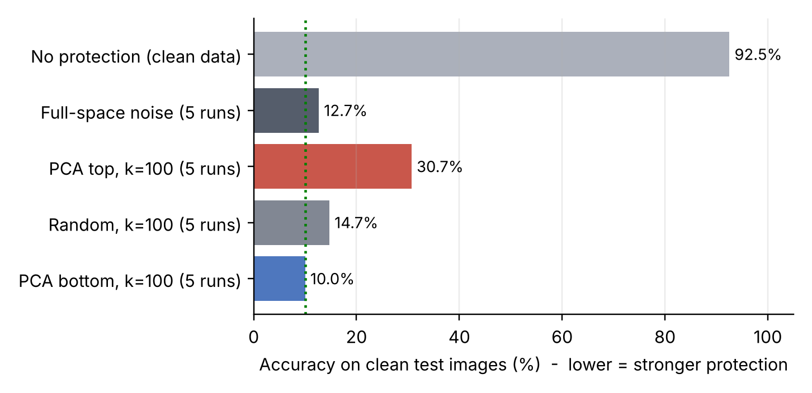

# Low-Dimensional Subspace Optimization for Unlearnable Data

A course project for **CS F320 Foundations of Data Science** at BITS Pilani Dubai.

Unlearnable data protects images from being used for training: a small, invisible perturbation (a "stamp") is added to each training image, so that a model trained on the stamped images learns the stamp instead of the content and fails on clean images. Existing class-wise methods let the stamp change all 3,072 values of a CIFAR-10 image freely. This project asks **how much of that freedom is needed**. We restrict each class stamp to a k-dimensional subspace built from PCA directions (top, middle or bottom of the ranking) or from random directions, optimise it with error-minimizing (min-min) noise under an L-infinity budget of 8/255, and measure how well it protects.

## Main results

ResNet-18 trained from scratch for 15 epochs on CIFAR-10, then scored on the 10,000 clean test images (76 runs in total).

| Stamp | Mean clean test accuracy | Protected runs (< 30%) |
|---|---|---|
| No stamp (baseline) | 92.5% | - |
| Full space, standard method (5 runs) | 12.7% | 5 of 5 |
| PCA bottom, k = 100 (5 runs) | 10.0% | 5 of 5 |
| Random, k = 100 (5 runs) | 14.7% | 5 of 5 |
| PCA top, k = 100 (5 runs) | 30.7% | 3 of 5 |

- Bottom-PCA stamps with k >= 100 gave exactly 10.0% (chance level) in all 8 runs, matching the standard full-space method with about 30 times fewer numbers (1,000 instead of 30,720 per stamp set).
- The kind of direction matters more than how many: fine-grain (bottom) directions protect fully, smooth (top) directions only partly.
- A small k is unreliable for every kind of direction. Runs end near 10% or near 92%, and protection can appear late in training (epochs 9-13).
- A frequency analysis is consistent with fine-grain stamps working best, but it is not a causal test.
- The restricted stamps are cheaper to describe, but not faster to generate.

## Repository contents

| Path | What it is |
|---|---|
| `notebooks/FDS_Training_Project.ipynb` | Experiment code: PCA, stamp optimisation, training and evaluation, and the queues of runs |
| `notebooks/FDS_Demo.ipynb` | Demo notebook: clean vs. protected images, a live check of the protected model, stamps and directions, frequency analysis, result plots |
| `results/results.csv` | One row per run (method, k, region, seed, clean test accuracy, L-infinity norm, seconds) |
| `figures/` | Result figures and the block diagram |

## Running the notebooks

Both notebooks were written for Google Colab with a GPU and keep their files in a Google Drive folder named `FDS_ULD_PCA` (cached CIFAR-10, saved stamps, models and `results.csv`). The saved stamps and model weights are not included in this repository because of their size. The notebooks show their saved outputs when opened on GitHub. To reproduce the results, run the training notebook's setup cells first and then the queue cells, which skip runs already recorded in `results.csv`.

## Limitations

One dataset (CIFAR-10), one model (ResNet-18), class-wise noise only, one budget (8/255) and a fixed 15-epoch recipe, with 3 to 5 runs per setting. Defences such as blurring or compressing images before training were not tested, and the comparison with recent unlearnable-data methods is qualitative.
